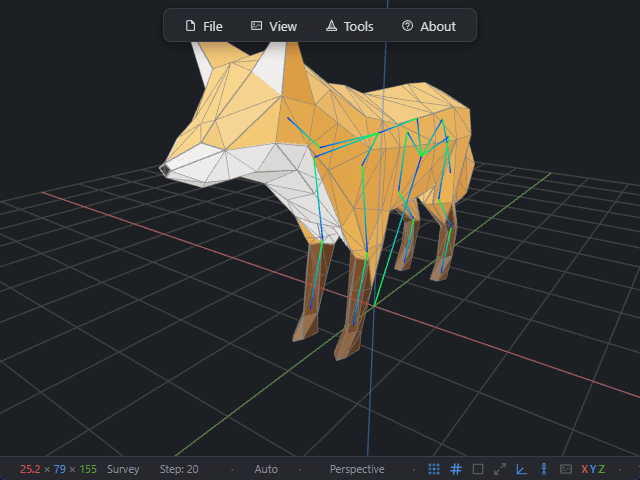

# !votekickViewer3D

A lightweight 3D model viewer for Windows. Double-click a model file in
Explorer and it opens instantly in a minimal viewer - the photo-viewer
experience, for 3D models. Free and open source (MIT).

<!-- Screenshot placeholder: drop a screenshot to docs/screenshot.png and
uncomment below.

-->

## Supported formats

| Format | Extension | Notes |
|---|---|---|
| glTF Binary | `.glb` | |
| glTF | `.gltf` | |
| Autodesk FBX | `.fbx` | textures are picked up from the model's folder |
| Wavefront OBJ | `.obj` | uses the sidecar `.mtl` and texture files |
| Stereolithography | `.stl` | ASCII and binary |
| Polygon File Format | `.ply` | ASCII and binary, vertex colors |
| COLLADA | `.dae` | |
| Autodesk 3DS | `.3ds` | |

## Install

1. Go to [Releases](https://github.com/votekickAlex/votekickViewer3D/releases)
2. Download `votekickViewer3D_<version>_x64-setup.exe` and run it
   - installs to `C:\Program Files\votekickViewer3D`
   - registers all formats above as default viewer
   - desktop / Start Menu shortcut: **!votekickViewer3D**

Or grab `votekickViewer3D_<version>-portable.zip` for a no-install,
standalone `votekickViewer3D.exe`.

Uninstalling is a standard Windows "Uninstall" - and the uninstaller's
"delete app data" checkbox decides whether your settings are removed too.

## Data locations

- Program: `C:\Program Files\votekickViewer3D`
- Settings: `%APPDATA%\votekickViewer3D\cfg`
- Cache: `%APPDATA%\votekickViewer3D\cache`

## Controls

> **Work in progress** - the interface is actively being reworked; this
> section will be finalized once the menu settles. Currently:
> `G` grid · `F` wireframe · `R` reset view · `Ctrl+O` open file.

Mouse: orbit / pan / zoom like any 3D viewer; a freshly opened model is
auto-framed to fit the window.

## Building from source

Requires Node.js and Rust (see [Tauri prerequisites](https://v2.tauri.app/start/prerequisites/)):

```sh
npm ci
npm run release   # builds installer + portable zip into release/
```

## License

[MIT](LICENSE)
